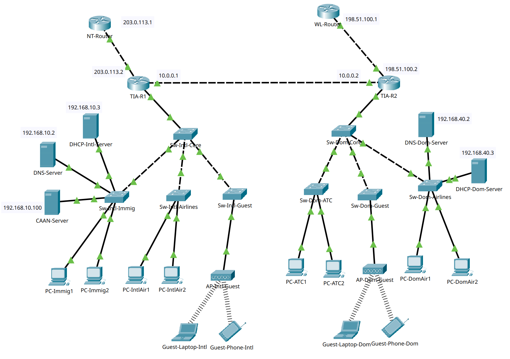

# TIA Network Design

A simple and practical airport network design project for
**Tribhuvan International Airport (TIA / VNKT)** using **Cisco Packet Tracer**.

## Overview

This academic Packet Tracer case study models a dual-terminal airport network. It is a simulation, rather than a description of TIA’s deployed infrastructure.
It separates the network into different parts for staff, airline offices, guests, and airport operations.

The goal is to make the network easy to understand, easy to manage, and safe for different types of users.

## Network Topology

  

This image shows the full visual layout of the airport network used in this project.

## Addressing and terminal roles

The plan below comes from Tables 1–3 in the [public report](report.pdf). Cisco 2911 router `TIA-R1` serves the International terminal and `TIA-R2` serves the Domestic terminal; access/core switching uses Cisco 2960-24TT devices.

| VLAN | Segment | Subnet | Gateway | Router |
| --- | --- | --- | --- | --- |
| 10 | Immigration and Authority | `192.168.10.0/24` | `192.168.10.1` | TIA-R1 |
| 20 | International Airlines | `192.168.20.0/24` | `192.168.20.1` | TIA-R1 |
| 30 | International Guest Wi-Fi | `192.168.30.0/24` | `192.168.30.1` | TIA-R1 |
| 40 | Domestic Airlines | `192.168.40.0/24` | `192.168.40.1` | TIA-R2 |
| 50 | Domestic Guest Wi-Fi | `192.168.50.0/24` | `192.168.50.1` | TIA-R2 |
| 60 | ATC and TETRA CNS | `192.168.60.0/24` | `192.168.60.1` | TIA-R2 |

The routers exchange routes in OSPF Area 0 over `10.0.0.0/30`. Each terminal has a Server-PT DHCP server with router DHCP relay. Extended named ACLs restrict the guest VLANs while permitting the guest portal; this is the policy modeled in the case study, not an independently assessed zero-trust deployment.

## Features

- Dual-terminal airport network design
- VLAN-based network segmentation
- Router-on-a-Stick for inter-VLAN routing
- OSPF routing between terminal routers
- Dedicated DHCP servers for automatic IP assignment
- DNS and HTTP services for name resolution and web access
- ACL-based guest isolation for better security
- Separate ISP/WAN connectivity for different terminal sides

## Quick Start

1. Open `TIA.pkt` in Cisco Packet Tracer.
2. Check the full network topology, devices, and links.
3. Open `report.pdf` to read the complete case study and design explanation.
4. Use `images/01_full_workspace.png` if you want a quick visual overview without opening Packet Tracer.

## Repository Contents

| File / Folder | Description |
|---|---|
| `TIA.pkt` | Main Cisco Packet Tracer project file |
| `report.pdf` | Final report for the project |
| `images/01_full_workspace.png` | Main topology image shown in this README |
| `LICENSE` | GNU GPL v3 license file |

## Requirements

To use this project, you mainly need:

- Cisco Packet Tracer 8.2 or later

## What This Project Covers

This project is useful for learning and demonstrating:

- VLAN design
- IP addressing
- inter-VLAN routing
- OSPF
- DHCP
- DNS
- HTTP setup
- ACL-based security
- airport network case study design

## Verification and team

Open the project and compare router subinterfaces, VLAN membership, OSPF neighbors, DHCP leases and guest/staff HTTP access with the report's configuration and test sections. Review denied guest-to-staff traffic as well as allowed portal traffic. The `.pkt` file has not been newly executed as part of this documentation update.

The March 2026 National College of Engineering report credits **Apoorva Paudel, Bikash Dhami and Suhan Khadka**. Individual contribution assignments are not recorded in this README; see the report title page for the original attribution.

## License

This repository is licensed under the **GNU General Public License v3.0**.
Please read the [LICENSE](LICENSE) file for full details.
